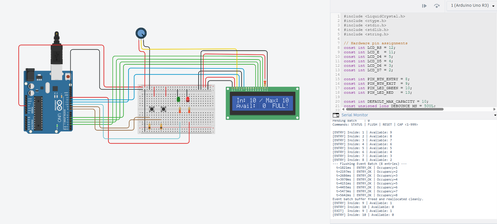
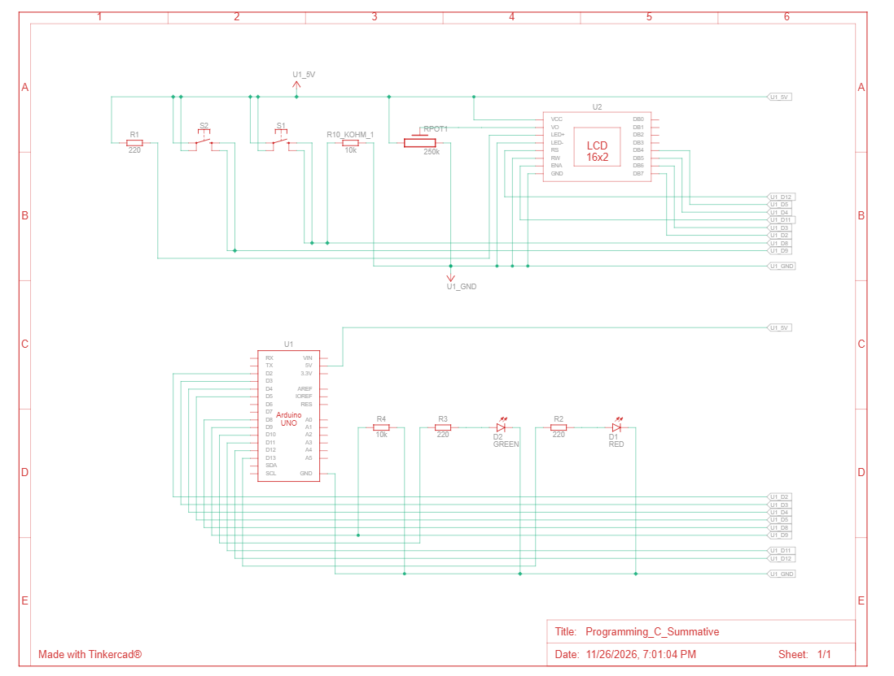

# Project 1: Smart Occupancy Monitoring and Access Control System

**Platform:** Arduino Uno R3 (Tinkercad Simulation + Host C Logic Verification)  
**Live Tinkercad Simulation:** [Open Circuit in Tinkercad](https://www.tinkercad.com/things/5wDUrUt1VvU-programmingcsummative/editel?returnTo=https%3A%2F%2Fwww.tinkercad.com%2Fdashboard&sharecode=BY5Ajtju3cqu1TmXfveYNvcJyJE61GWgE0YOFlfred4)  
**Source Files:**
- `smart_occupancy.ino`: Arduino controller sketch driving buttons, LEDs, 16x2 LCD, and Serial commands
- `wiring_guide.md`: Tinkercad breadboard & 16x2 LCD pin map + simulation checklist
- `logic_test/occupancy_core.h`, `occupancy_core.c`, `test_occupancy.c`: Host C logic unit tests





---

## Core Design Highlights
1. **Non-Blocking Timing (`millis()`):** Zero `delay()` calls inside `loop()`. Entry (`D8`) and Exit (`D9`) buttons run independent 50 ms rising-edge state machines (`updateButtonDebounced`) so holding a button down increments or decrements occupancy once per press. The 16x2 LCD refreshes every 250 ms via a `lcdDirty` flag without freezing button reads.
2. **Structs, Pointers, and Dynamic SRAM:** Occupancy counters live inside a heap `OccupancyRecord` allocated via `calloc(1, sizeof(OccupancyRecord))`, checked for `NULL`, and passed by pointer (`OccupancyRecord *rec`). An 8-slot `EventEntry` batch log allocated via `malloc()` records event timestamps and flushes to Serial Monitor using `free()` followed by reallocation (and full `free()` cleanup on `RESET`).
3. **Capacity Guards and Status LEDs:**
   - **Available (`0 <= currentCount < maxCapacity`):** Green LED (`D10`) stays `HIGH`, Red LED (`D13`) stays `LOW`.
   - **Full (`currentCount == maxCapacity`):** Green LED (`D10`) stays `LOW`, Red LED (`D13`) stays strictly `HIGH` (including when blocked entry presses are attempted).
   - Invalid exits at `0` or entries at max capacity keep counters within `[0, maxCapacity]` and log `[ERROR]` messages over `9600` baud Serial.
4. **Why `logic_test/` Exists:** Browser circuit simulators cannot run automated assertions in CI/CLI. Extracting the exact state, debounce, and batch-log lifecycle into plain C (`occupancy_core.c`) lets `test_occupancy.c` test switch bounce windows, boundary clamps, and `free()`/reallocation deterministically with `gcc`.
5. **Interactive Serial Commands:** Send `STATUS`, `FLUSH`, `RESET`, or `CAP <1-999>` in Tinkercad's Serial Monitor to inspect stats, trigger `free()`/reallocation cycles, or adjust capacity live.

---

## Host Logic Verification (Ubuntu / WSL)
```bash
gcc -Wall -Wextra -Werror -std=c99 Project1_Smart_Occupancy/logic_test/occupancy_core.c Project1_Smart_Occupancy/logic_test/test_occupancy.c -o /tmp/test_p1 && /tmp/test_p1
```
Output:
```text
[PASS] Project 1 occupancy core & debounce unit tests succeeded.
```
