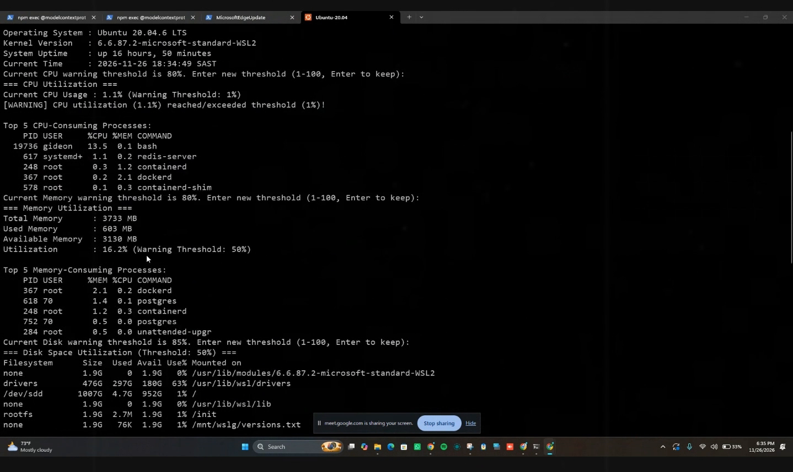
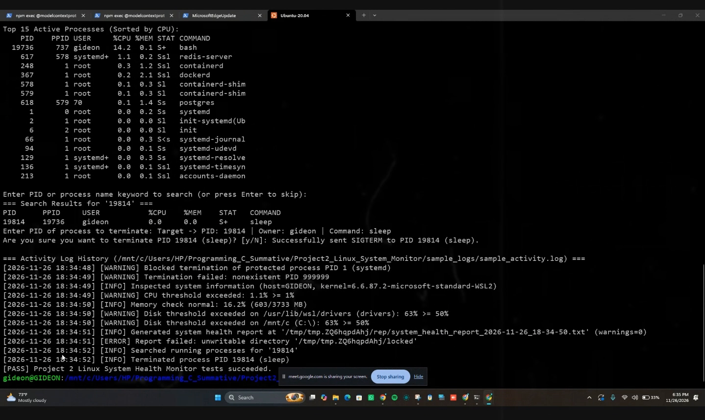

# Project 2: Linux System Health and Resource Monitoring Manager

**Platform:** Linux / WSL (`Ubuntu 20.04.6 LTS`, Bash 5.x, standard POSIX/procps utilities)  
**Source Files:**
- `system_monitor.sh`: Interactive 10-option system monitoring and process management manager
- `test_monitor.sh`: Automated 5-stage WSL verification suite
- `sample_reports/sample_health_report.txt`: Captured health snapshot from live WSL run
- `sample_logs/sample_activity.log`: Captured audit trail from live WSL run

---

## Design Decisions and Architecture

1. **Direct `/proc` Telemetry (`get_cpu_usage_pct` and `get_memory_stats`):**
   Optional monitoring packages such as `sysstat` (`mpstat`) are not always present on default Linux installs. Reading `/proc/stat` across two jiffie snapshots 0.5 seconds apart and parsing `MemTotal` vs. `MemAvailable` from `/proc/meminfo` with `awk` works out of the box, with `top` and `free` kept as clean fallbacks. When required utilities (`ps`, `df`, `kill`) are queried, `require_cmd` verifies availability and logs missing tools cleanly.
2. **Protected System Process & Ownership Guards:**
   Killing system-critical Linux services can crash init or lock out a live session. Before calling `kill -TERM`, `terminate_process` runs three checks: positive integer validation, `is_protected_process` filtering (`PID <= 1`, the running script `$$`, its parent `$PPID`, kernel threads where `PPID = 2`, and daemons such as `systemd`, `init`, `sshd`, `dbus-daemon`, and `wslinit`), non-root UID ownership checks, and interactive `[y/N]` confirmation.
3. **Pipe and Flag Safety Under Strict Bash Options:**
   `system_monitor.sh` runs under `set -u`, while automated verification in `test_monitor.sh` executes under `set -euo pipefail`. Testing under `test_monitor.sh`'s `set -euo pipefail` exposed two real failure modes: section dividers beginning with `---` need `printf --` so Bash does not read dashes as options, and piping `ps` into `head -n 6` can close stdin early and raise `SIGPIPE` (`141`) under `pipefail`. Replacing `head` with `awk 'NR<=N'` drains stdin cleanly and avoids false pipe exits.
4. **Permission-Checked Health Reports and Persistent Logging:**
   Every check, threshold warning, blocked termination, and error appends a timestamped entry to `system_monitor_activity.log`. Health report exports validate target directories, create missing folders cleanly, check write permissions before opening the output stream (`if ! { ... } > "$report_path"; then`), and track total threshold warnings across CPU, memory, and disk sections.

---

## How to Run and Verify

```bash
cd Project2_Linux_System_Monitor
chmod +x system_monitor.sh test_monitor.sh

# Launch interactive 10-option menu
./system_monitor.sh

# Run automated 5-stage verification suite
bash test_monitor.sh
```

### Verified WSL Run Screenshots & Summary (`test_monitor.sh`)





```text
[1/5] Checking Bash syntax...
[2/5] Testing threshold validation and protected process guards...
[3/5] Testing system telemetry functions and sample health report...
=== CPU Utilization ===
Current CPU Usage : 0.2% (Warning Threshold: 1%)
=== Memory Utilization ===
Utilization       : 16.4% (Warning Threshold: 50%)
Total Memory      : 3733 MB | Used Memory: 611 MB | Available Memory: 3122 MB
=== Disk Space Utilization (Threshold: 50%) ===
[WARNING] Filesystem 'drivers' mounted at '/usr/lib/wsl/drivers' is at 64% (>= 50%)!
[WARNING] Filesystem 'C:\' mounted at '/mnt/c' is at 64% (>= 50%)!
[4/5] Testing unwritable directory handling...
[5/5] Testing process search and safe child process termination...
[PASS] Project 2 Linux System Health Monitor tests succeeded.
```
