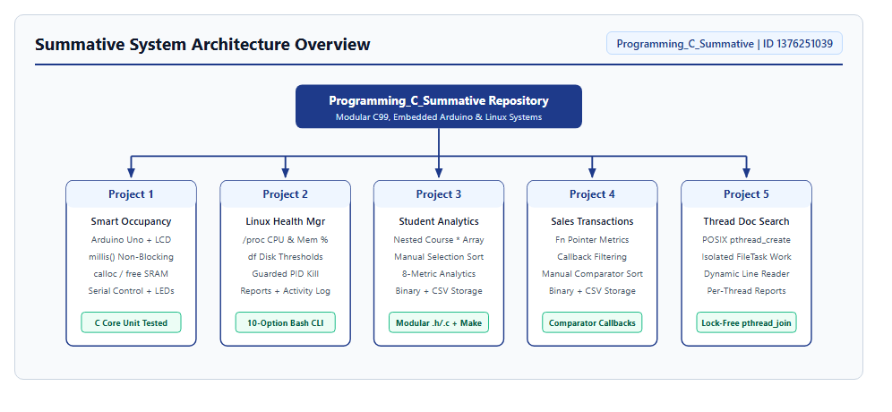

# Programming in C - Summative Portfolio

**Student:** Erioluwa Gideon Olowoyo  
**Student ID:** 1376251039  
**Programme:** BSc (Hons) Software Engineering, African Leadership University  
**Repository:** https://github.com/Code-with-Gideon/Programming_C_Summative  
**Project 1 Live Simulation:** [Open in Tinkercad](https://www.tinkercad.com/things/5wDUrUt1VvU-programmingcsummative/editel?returnTo=https%3A%2F%2Fwww.tinkercad.com%2Fdashboard&sharecode=BY5Ajtju3cqu1TmXfveYNvcJyJE61GWgE0YOFlfred4)



---

## Project Navigation

| Project | System Scope | Core Stack & Architecture | Verification Status | Folder |
| :--- | :--- | :--- | :--- | :--- |
| **1** | Smart Occupancy Monitoring & Access Control | Arduino Uno R3, 16x2 LCD, `millis()` FSM, `calloc`/`free` SRAM, host C test core | Passed `gcc -Werror` host tests | [Project1_Smart_Occupancy/](Project1_Smart_Occupancy/) |
| **2** | Linux System Health & Resource Manager | Modular Bash, direct `/proc` telemetry, protected PID checks, reports & activity log | Passed all 5 WSL Bash checks | [Project2_Linux_System_Monitor/](Project2_Linux_System_Monitor/) |
| **3** | Student Academic Records & Analytics | Multi-file C99 (`include/` + `src/`), nested `Course *`, in-place selection sort, SREC binary + CSV | Passed `gcc -Werror` + WSL tests | [Project3_Student_Analytics/](Project3_Student_Analytics/) |
| **4** | Sales Transaction Processing System | Multi-file C99, `SalesMetricFn` dispatch table, `TxPredicateCb` (`void *ctx`), comparator sort, STXN binary + CSV | Passed `gcc -Werror` + WSL tests | [Project4_Sales_Analysis/](Project4_Sales_Analysis/) |
| **5** | Multi-Threaded Document Search Engine | POSIX `pthread_create` / `pthread_join`, lock-free `FileTask` isolation, dynamic line reader | Passed `gcc -Werror -pthread` + WSL tests | [Project5_Multithreaded_Search/](Project5_Multithreaded_Search/) |

---

## Engineering Decisions and Why

1. **Standalone Modular Layout Per Project:** Each project sits in its own directory with its own entry point (`main()` or executable script), separated `.h` / `.c` modules (Projects 3 to 5), build rules, sample data/outputs, automated tests, and technical `README.md`.
2. **Non-Blocking Embedded Control (Project 1):** Using `millis()` timers for 50 ms button rising-edge debouncing and 250 ms LCD refreshes keeps buttons responsive at all times with zero `delay()` calls. Holding occupancy counters in `calloc()` and flushing 8-event logs via `free()` + re-`malloc()` keeps AVR SRAM bounded and leak-free, while Red LED (`D13`) remains strictly `HIGH` at capacity.
3. **Zero Optional Package Dependencies & Pipe Safety in Bash (Project 2):** Parsing `/proc/stat` and `/proc/meminfo` directly removes dependency on optional packages like `sysstat`. Under `set -euo pipefail`, switching `| head -n N` to `| awk 'NR<=N'` avoids `SIGPIPE` aborts, and `printf --` prevents `---` section headers from triggering flag errors.
4. **Explicit Heap Ownership and Hand-Written Sorting (Projects 3 & 4):** Both C console systems grow and shrink arrays dynamically with `calloc`/`realloc`/`free`, validate dates/marks/IDs on input, implement in-place Selection Sort directly over element pointers, and store both binary formats (`SREC`, `STXN`) and CSV exports.
5. **Lock-Free Per-Thread Isolation (Project 5):** Giving each `pthread` its own `FileTask` struct and private `<filename>_report.txt` output removes shared mutable state during scanning, preventing race conditions without mutex contention. Missing files capture `strerror(errno)` locally while sibling threads finish normally.

---

## Quick Verification Guide (Linux / WSL)

```bash
# Project 1 host C logic core check
gcc -Wall -Wextra -Werror -std=c99 Project1_Smart_Occupancy/logic_test/occupancy_core.c Project1_Smart_Occupancy/logic_test/test_occupancy.c -o /tmp/test_p1 && /tmp/test_p1

# Project 2 Linux Bash monitor suite
bash Project2_Linux_System_Monitor/test_monitor.sh

# Project 3 Student Analytics build + test
make -C Project3_Student_Analytics clean all test

# Project 4 Sales Transaction Analysis build + test
make -C Project4_Sales_Analysis clean all test

# Project 5 Multi-Threaded Document Search build + test
make -C Project5_Multithreaded_Search clean all
bash Project5_Multithreaded_Search/tests/test_p5.sh
```
